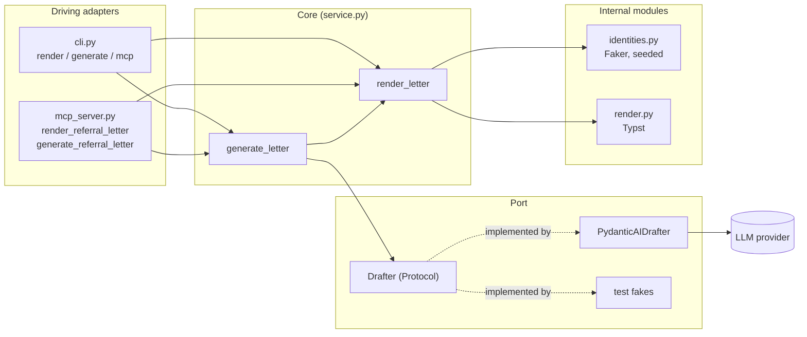

# AetioReferral Developer Guide

This guide covers setup, configuration, architecture, the interfaces (core, MCP server, CLI), localisation, testing and the design decisions behind AetioReferral, a service that renders synthetic medical referral letters as PDF. For what the project is and a quick start, see the [README](README.md).

AetioReferral is stateless: there is no database and no file is written except the PDF you ask for. Two async functions form the core; the CLI and the MCP server are thin adapters over them.

## Table of contents

- [Requirements and setup](#requirements-and-setup)
- [Configuration](#configuration)
- [Architecture](#architecture)
- [Core interface](#core-interface)
- [Letter model](#letter-model)
- [Identity filling](#identity-filling)
- [Rendering](#rendering)
- [Localisation](#localisation)
- [LLM drafter](#llm-drafter)
- [MCP server](#mcp-server)
- [CLI](#cli)
- [AetioMed integration](#aetiomed-integration)
- [Testing](#testing)
- [Design decisions](#design-decisions)
- [Future work](#future-work)

## Requirements and setup

- Python 3.13 (`requires-python = ">=3.13"`, pinned in `.python-version`)
- [uv](https://docs.astral.sh/uv/)

```sh
git clone https://github.com/janthoXO/AetioReferral.git
cd AetioReferral
uv sync
uv run aetioreferral --help
```

Typst is a Python wheel (the `typst` package), so no separate Typst install is needed.

### Project layout

```
pyproject.toml                 dependencies, the `aetioreferral` script, ruff and pyright settings
.env.example                   ready-made LLM_* blocks (copy to .env)
examples/letter.json           a complete LetterSpec
src/aetioreferral/
├── cli.py                     CLI (pydantic-settings CliApp): render, mcp, and generate when an LLM is configured
├── mcp_server.py              MCP server: build_server(drafter) registers the tools
├── service.py                 the core: render_letter and generate_letter
├── letter.py                  pydantic models: LetterSpec, PatientIn, DoctorIn, Section, RenderedLetter
├── identities.py              fills missing patient/sender/recipient/date with seeded Faker data
├── render.py                  builds the template data (view) and compiles the PDF with Typst
├── locale.py                  locale lookup and loading (TOML)
├── locales/de.toml, en.toml   every word and convention the service adds itself
├── template/letter.typ        DIN 5008 Form B layout, no words of its own
├── template/fonts/            bundled Carlito and Herr Von Muellerhoff (OFL) with their licences
├── drafter.py                 Drafter port, PydanticAIDrafter, DraftedLetter, the prompt
└── config.py                  LlmSettings and the three-state LLM_* gating
tests/test_service.py          the whole test suite
```

## Configuration

The LLM is optional. It is configured through `LLM_*` environment variables, or a `.env` file in the working directory. Copy `.env.example` to `.env`; it has blocks for Anthropic, OpenAI, Google, OpenRouter and a local Ollama. `.env` is git-ignored.

| Variable | Meaning |
| --- | --- |
| `LLM_PROVIDER` | pydantic-ai provider name |
| `LLM_MODEL` | model name for that provider |
| `LLM_URL` | base URL of the provider, optional |
| `LLM_API_KEY` | API key, optional |

Rules, from `src/aetioreferral/config.py`:

- `.env` is read from the **working directory**. Real environment variables win over `.env`. Other keys in `.env` are ignored.
- **Three states.** Provider and model both set: the generate path is on. None of the four variables set: it is off, and there is no `generate` subcommand and no `generate_referral_letter` tool. Anything in between is a startup error that names the missing variable, for example `error: LLM_MODEL set but LLM_PROVIDER missing`. A lone `LLM_URL` or `LLM_API_KEY` counts as partial and names both `LLM_PROVIDER` and `LLM_MODEL`.
- **Provider names** are pydantic-ai provider names. `anthropic`, `openai`, `google`, `openrouter` and `ollama` work with the installed extras (`pydantic-ai-slim[anthropic,google,openai]`; `openrouter` and `ollama` go through the OpenAI-compatible client). Others such as `mistral` or `groq` need their pydantic-ai extra added to the environment first.
- `LLM_URL` is the provider's base URL, passed to the provider as `base_url`. For `ollama` it is required (for example `http://localhost:11434/v1`).
- `LLM_API_KEY` is held as a `SecretStr`. Empty values are not passed on.

## Architecture

AetioReferral follows ports and adapters. The core is two async functions. Driving adapters (CLI, MCP server) call it; the one outbound port is the `Drafter`.



**Why only the Drafter is a port.** It is the only dependency with two implementations: the real pydantic-ai agent and a fake in tests. It is also the only optional one: when no drafter exists, the generate path is switched off entirely. Faker and Typst are internal modules. They are deterministic and cheap, so tests run them for real instead of faking them, and putting an interface in front of each would add code without adding a second implementation.

`cli.py` and `mcp_server.py` are the only modules that know about the outside world. `cli.drafter()` (cached) builds the `PydanticAIDrafter` from `LlmSettings` or returns `None`, and passes it to `build_server`.

## Core interface

`src/aetioreferral/service.py`:

```python
async def render_letter(spec: LetterSpec, *, seed: int | None = None) -> RenderedLetter
async def generate_letter(description: str, drafter: Drafter, *, language: str | None = None, seed: int | None = None) -> RenderedLetter
```

`render_letter` fills every missing identity field (see [Identity filling](#identity-filling)) and renders the PDF. `generate_letter` validates `language` (when given), asks the drafter for a `LetterSpec` and passes it to `render_letter`. `language=None` means the language of the description.

`RenderedLetter` (`letter.py`):

| Field | Type | Meaning |
| --- | --- | --- |
| `pdf` | `bytes` | the PDF |
| `letter` | `LetterSpec` | the input with every generated field filled in |
| `seed` | `int` | pass back with the same input to reproduce the letter |

**Determinism.** The same `LetterSpec` and seed give the same letter (the filled `LetterSpec` is identical). Without a seed, `new_seed()` draws a random one below 2^31, and it is always returned. For `generate_letter` the seed drives only the identities: the LLM output is not reproducible, so feed the returned `letter` to `render_letter` with the seed to reproduce a PDF. The letter date defaults to today, so reproduction on another day needs `date` set (the returned `letter` has it).

**Async.** Both functions are coroutines. The Typst compile is blocking, so `render_pdf` runs it in a worker thread with `anyio.to_thread.run_sync`, which keeps the MCP event loop responsive. The CLI wraps calls in `anyio.run`.

## Letter model

`LetterSpec` (`letter.py`) is both the input of `render_letter` and, through its field descriptions, the MCP tool schema.

| Field | Type | Meaning |
| --- | --- | --- |
| `language` | `str`, default `"de"` | BCP 47 tag selecting the locale; must resolve to a locale file (JSON schema carries an `enum` of supported tags) |
| `recipient_specialty` | `str`, required | specialty the patient is referred to; shown as "Überweisung an: ..." and the default recipient specialty |
| `reason` | `str`, required | Fragestellung: what is asked of the specialist |
| `request` | `str \| None` | kind of referral completing the intro sentence; default from the locale (`default_request`) |
| `urgent` | `bool`, default `False` | prints an urgent mark |
| `suspected_diagnosis` | `str \| None` | Verdachtsdiagnose |
| `diagnoses` | `str \| None` | known diagnoses and pre-existing conditions |
| `history` | `str \| None` | Anamnese |
| `findings` | `str \| None` | Befunde |
| `prior_treatment` | `str \| None` | treatment so far |
| `medication` | `str \| None` | current medication, one per line |
| `allergies` | `str \| None` | allergies and intolerances |
| `extra_sections` | `list[Section]` | further `{heading, text}` sections, printed after allergies |
| `attachments` | `list[str]` | Anlagen, printed as a list at the end |
| `patient` | `PatientIn \| None` | see the three states below |
| `sender` | `DoctorIn` | referring doctor |
| `recipient` | `DoctorIn` | receiving doctor or practice |
| `date` | `date \| None` | letter date; today if missing |

`PatientIn` fields: `sex` (`f`, `m`, `d`), `name`, `birth_date`, `age` (0 to 120, used only when `birth_date` is missing), `address`, `insurer`, `insurance_number`. `DoctorIn` fields: `name`, `title`, `specialty`, `practice`, `address`, `phone`, `fax`, `identifiers` (dict keyed by the locale's scheme). All are optional.

**Section order in the PDF**, from `SECTION_FIELDS` in `render.py` followed by `extra_sections`: suspected diagnosis, diagnoses, reason, history, findings, prior treatment, medication, allergies, then each extra section in the given order. Attachments come last, after the signature block. Headings of the fixed sections come from the locale `[labels]`.

**Text.** All sections are plain text. `"\n\n"` starts a paragraph and `"\n"` is a line break. A section with empty or missing text is omitted, heading included. Content is never translated; only labels and phrases come from the locale.

**Patient states.**

| `patient` in the input | Result |
| --- | --- |
| omitted or `{}` | the whole patient is generated |
| partly filled, e.g. `{"sex": "f", "age": 54}` | given fields kept, the rest generated |
| `null` | no patient block; the intro uses `intro_without_patient` |

**Sender and recipient defaults.** The sender's specialty defaults to the locale's `default_sender_specialty`; the recipient's to `recipient_specialty`. Practice defaults to the locale phrase `practice` with the doctor's full name.

## Identity filling

`identities.fill(spec, seed)` returns a copy of the spec with every gap filled. Rules:

- A `Faker` instance is created for the locale's `faker_locale` and seeded with `seed` (`seed_instance`). Same spec and seed give the same people.
- **Given values always win.** Only missing (`None` or empty) fields are generated. Exceptions: `title` is generated only when `None`, so `""` means "no title"; `identifiers` is merged per key, given keys win.
- `date` defaults to today.
- Doctors: name from Faker; title from `doctor_titles`; practice from the `practice` phrase; address, phone and fax from Faker; identifiers: one random 9-digit number per key in `identifier_keys`.
- Patient: `sex` is random `f` or `m` when missing (`d` is only used if given). Name uses the first-name list matching the sex. Without `birth_date`, `age` (random 18 to 90 if also missing) gives a birth date that makes the patient exactly that age on the letter date, with a random day offset within the year; 29 February falls back to the 28th. Insurer is a random pick from the locale's `insurers` (none if the list is empty). The insurance number follows `insurance_number_format` via Faker `bothify`.
- Identifiers are random digits without check digits, so they are not valid LANR or BSNR numbers. Valid check digits are future work ([#2](https://github.com/janthoXO/AetioReferral/issues/2)).
- `age` is kept in the returned patient as given; it is not recomputed when a `birth_date` is supplied as well.

## Rendering

`render.py` compiles `template/letter.typ` with the `typst` Python package:

```python
typst.compile(TEMPLATE_DIR / "letter.typ", font_paths=[TEMPLATE_DIR / "fonts"], ignore_system_fonts=True, sys_inputs={"data": data})
```

- **Data as JSON in `sys_inputs`.** `view(letter)` builds a dict, `json.dumps` turns it into one string, and the template reads it with `json(bytes(sys.inputs.data))`. The text is only ever data. It is never evaluated as Typst markup, so letter content cannot inject markup or commands. Prose is split on `"\n\n"` and `"\n"` by a template function, and set as plain strings.
- **Bundled fonts.** Carlito (a Calibri-metric font) and Herr Von Muellerhoff (script font for the signature), both under the SIL OFL (licences are in `template/fonts/`). System fonts are ignored, so output does not depend on the machine.
- **Layout.** DIN 5008 Form B on A4: letterhead, fold and hole marks, address field with a return-address line, date at the right, then the body. The signature is the sender's name in the script font, slightly rotated, next to a blue stamp built from practice, address and identifiers. Page numbers `n / N` appear from page 2. The closing and signature block never split from each other across pages.
- **The template holds no words.** Every visible string is in the data, from the locale or from the caller.

### The `view()` data contract

`view(letter)` needs a completed letter (patient `sex` and `birth_date`, and `date`, are asserted). Keys the template receives:

| Key | Type | Content |
| --- | --- | --- |
| `lang` | string | base language of `language` (e.g. `de`), used for Typst's hyphenation and typographic rules |
| `sender` | doctor object | see below; identifiers limited to the locale's `identifier_keys` |
| `recipient` | doctor object | same shape; `identifiers` always empty |
| `date` | string | letter date in the locale's `date_format` |
| `patient` | object or `null` | `line`: title, name and the locale's `born` label with the birth date; `details`: address (newlines as ", "), insurer and insurance number joined by " · " |
| `referral` | string | "label: recipient_specialty", e.g. "Überweisung an: Gastroenterologie" |
| `urgent` | string or `null` | the locale's `urgent` label when `urgent` is true |
| `salutation` | string | locale phrase |
| `intro` | string | `intro` (with the patient noun) or `intro_without_patient`, with `{request}` filled |
| `sections` | list of `{heading, text}` | non-empty fixed sections in order, then extra sections |
| `closing` | string | locale phrase |
| `attachments` | `{heading, items}` or `null` | `null` when there are none |

Doctor object: `name` (title and name), `signature` (name only), `specialty`, `practice`, `address` (list of lines), `contact` (list of "Tel. ..." and "Fax ..." strings, empty ones dropped), `identifiers` (list of "KEY value" strings).

## Localisation

Each language is one TOML file in `src/aetioreferral/locales/`, named by its tag. `de.toml` and `en.toml` ship. Keys of `de.toml`:

| Key | Meaning |
| --- | --- |
| `faker_locale` | Faker locale for names, addresses and phone numbers, e.g. `de_DE` |
| `date_format` | `strftime` format for the letter and birth dates |
| `identifier_keys` | doctor identifier scheme (`["BSNR", "LANR"]`); drives the generated identifiers and the letterhead and stamp lines; `[]` for none |
| `default_sender_specialty` | sender specialty when none is given |
| `doctor_titles` | pool for generated titles; repeat an entry to weight it, `""` means no title |
| `insurers` | pool of insurer names; empty list means no insurer is generated |
| `insurance_number_format` | Faker `bothify` pattern: `?` letter, `#` digit |
| `[labels]` | `suspected_diagnosis`, `diagnoses`, `reason`, `history`, `findings`, `prior_treatment`, `medication`, `allergies` (section headings), `attachments`, `urgent`, `referral_to`, `born`, `phone`, `fax`, `insurance_number` |
| `[phrases]` | `salutation`, `intro` (placeholders `{patient}`, `{request}`), `intro_without_patient` (`{request}`), `default_request`, `closing`, `practice` (`{doctor}`) |
| `[patient_title]` | `f`, `m`, `d`: title before the patient name |
| `[patient_noun]` | `f`, `m`, `d`: noun for the intro sentence, in the grammatical case the sentence needs |

**Lookup** (`locale.py`): `resolve_language(tag)` matches the exact tag first (`de-CH` if `de-CH.toml` exists), then the base language (`de-AT` becomes `de`), case-insensitively. `load_locale` reads and caches the file.

**Unsupported language** is a validation error listing the supported tags (`unsupported language 'xx', supported: de, en`). `LetterSpec` validates `language`, so it fails at the model, in the CLI and in the MCP tool alike; `generate_letter` also checks an explicit `language` before calling the LLM. The `language` field's JSON schema carries an `enum` of the supported tags, so MCP clients and the LLM see the list.

**Adding a language.** Copy `de.toml` to `<tag>.toml` and translate the values. Keep the keys identical: a test compares every locale file's keys with `de.toml`. No code change is needed, and the tool schema picks the new tag up automatically. Region variants (for example `de-CH`) are future work ([#4](https://github.com/janthoXO/AetioReferral/issues/4)).

**Why TOML, not YAML.** `tomllib` is in the standard library, so there is no dependency. TOML has no implicit typing: YAML 1.1 would read an unquoted `no` (Norwegian "no", or a label) as `false`.

## LLM drafter

`drafter.py`:

- `Drafter` is a `Protocol` with one method: `async def draft(description, language) -> LetterSpec`.
- `PydanticAIDrafter` wraps a pydantic-ai `Agent` with `output_type=DraftedLetter`, `instructions=INSTRUCTIONS` and `retries=3`. Structured output is validated against the model, and a failed validation is retried up to three times.
- `DraftedLetter` is `LetterSpec` with `language` required (no default), so the model must choose the language instead of inheriting `"de"`. When the caller passes a `language`, the prompt gets a `Letter language: <tag>` line and the result's `language` is overwritten with it.
- **Prompt rules** (`INSTRUCTIONS`), in plain words: mirror a real referral letter, filling the sections a real doctor would write and leaving the others empty; add plausible clinical detail consistent with the description (symptom course, findings, tests, medication with doses) and phrase the reason as a question; the description wins when it asks for something else; plain text in the letter language, one medication per line; identity fields only when the description states them, and stated facts (age, sex, named doctors) are always copied, with `patient` null only if the description asks for no patient details; letter language is the given one, otherwise the description's, set as a BCP 47 tag; no salutation, opening or closing, because they are added automatically.
- **Banner.** `pydantic_ai.BANNER_ENABLED = False` is set at import. The first-run banner would otherwise be written to stdout and corrupt the MCP stdio stream.
- **Provider construction.** `infer_model(f"{provider}:{model}", provider_factory=...)` where the factory calls `infer_provider_class(name)(**options)` with `base_url` and `api_key` taken from the settings (empty values dropped). This builds any pydantic-ai provider from its name without a per-provider branch.

**Observed model quality.** Small local models were unreliable at following the schema and prompt rules (qwen3:14b in particular). `gemma4:12b` and cloud models are recommended.

## MCP server

`mcp_server.py` uses the official `mcp` SDK 2.x. `MCPServer` is the class formerly known as FastMCP. `build_server(drafter)` registers the tools; the generate tool exists only when a drafter is passed.

| Tool | Arguments | Availability |
| --- | --- | --- |
| `render_referral_letter` | `letter` (a `LetterSpec`), `seed` (optional int) | always |
| `generate_referral_letter` | `description` (string), `language` (optional BCP 47 tag), `seed` (optional int) | only with LLM configuration |

**Transports.** `aetioreferral mcp` serves stdio. `aetioreferral mcp --http` serves streamable HTTP on `127.0.0.1:8000` at path `/mcp` (`--host` and `--port` override). There is **no authentication** on the HTTP transport: bind it locally only. Auth is future work ([#7](https://github.com/janthoXO/AetioReferral/issues/7)).

**Result format.** Both tools return a `CallToolResult` with:

- `content`: one `EmbeddedResource` holding `BlobResourceContents` with `mime_type="application/pdf"`, a base64 `blob` and the uri `letter://<seed>.pdf`;
- `structured_content`: `{"letter": <completed LetterSpec as JSON>, "seed": <int>}`.

**Errors** (invalid letter, unsupported language, LLM failure) are raised inside the tool and reach the client as tool errors (`is_error`), not as protocol errors.

Example client, the same pattern the tests use (in-process, no transport):

```python
import base64
from mcp import Client
from aetioreferral.mcp_server import build_server


async def main():
    async with Client(build_server(None)) as client:
        result = await client.call_tool(
            "render_referral_letter",
            {"letter": {"recipient_specialty": "Kardiologie", "reason": "Belastungsdyspnoe", "patient": {}}, "seed": 5},
        )
    assert not result.is_error
    pdf = base64.b64decode(result.content[0].resource.blob)
    letter, seed = result.structured_content["letter"], result.structured_content["seed"]
```

For an external server use the same `Client` API with the server's transport; see the MCP SDK documentation.

## CLI

`cli.py` uses pydantic-settings' CLI support: `CliApp`, `CliSubCommand` and `CliPositionalArg` on plain pydantic models, wired with a `CliSettingsSource` (`cli_kebab_case=True`, `cli_implicit_flags=True`).

**Two root classes.** `App` has `render` and `mcp`. `AppWithGenerate(App)` adds `generate`. `main()` picks `AppWithGenerate` only when `drafter()` is not `None`, so `generate` does not exist (not in `--help`, not callable) without LLM configuration.

```
aetioreferral {render,mcp}                  # plus generate with LLM_* configured
```

| Command | Arguments and flags |
| --- | --- |
| `render FILE` | `FILE` LetterSpec JSON, `-` reads stdin; `-o, --output PATH` PDF to write (required); `--seed INT` reproduce an earlier letter |
| `generate DESCRIPTION` | `DESCRIPTION` free text; `-o, --output PATH` (required); `--language TAG` BCP 47, default is the description's language; `--seed INT` seed for the identities |
| `mcp` | `--http` / `--no-http` serve streamable HTTP instead of stdio (default off); `--host STR` (default `127.0.0.1`); `--port INT` (default `8000`) |

On success `render` and `generate` write the PDF and print `wrote <path> (seed <n>)` to stderr. stdout stays empty.

**Errors.** `main()` catches `ValidationError`, `ValueError`, `OSError` and pydantic-ai's `UnexpectedModelBehavior`, prints `error: <message>` to stderr and exits with status 1. This covers a missing input file, invalid JSON or letter fields, an unsupported language, partial `LLM_*` configuration and a model that never produced valid output. Argument errors are argparse's (status 2).

## AetioMed integration

AetioMed builds one outline as the single source of truth and fans it out to generators that run in parallel. Each generator only re-renders facts from the outline. The chief-complaint generator, where the letter lives, sees only the Patient and Chief complaint sections. The anamnesis generator runs at the same time and sees only the Anamnesis section.

For that reason:

- AetioMed fills `recipient_specialty`, `request`, `urgent`, `reason`, `history` (the symptom course from the referral), `findings` (the GP's findings) and `suspected_diagnosis`.
- It leaves `diagnoses`, `medication`, `allergies`, `prior_treatment` and `extra_sections` empty. The chief-complaint generator cannot see the Anamnesis section, so filling them would invent facts that may contradict the parallel anamnesis.
- It sends `"patient": null`. The letter then has no patient block and no name that could differ from the case's patient.
- The Verdachtsdiagnose follows AetioMed's case recipe (janthoXO/AetioMed#216, `02-plan/02-outline/recipe.ts`), which rolls per case whether the referral carries a suspicion and whether it is correct, partial or wrong. The suspicion already sits in the Chief complaint section. The prompt rule in `chief-complaint/gateway.ts` (lines 54 and 56) serves this and stays.
- No ICD code from AetioMed reaches the letter: the recipe label is text, and the outline never names the true diagnosis outside it.
- AetioMed's request language is passed as `language`.

Known gap: the outline prompt (`02-plan/02-outline/gateway.ts:100`) only asks "who referred, when, and the reason", so `findings` is often empty. Fixing this is future work in AetioMed (issue #9).

## Testing

```sh
uv run pytest
uv run ruff check
uv run ruff format
uv run pyright          # checks src/ only
```

All tests live in `tests/test_service.py` (12 tests). They go through the core interface, not through internals, and use the real Typst compile. The PDF text is extracted with `pypdf` and asserted on. The LLM is replaced by a `FakeDrafter` implementing the `Drafter` protocol. The MCP server is exercised with the in-memory `mcp.Client`. An autouse fixture changes into a temp directory and clears the `LLM_*` variables, so a developer's `.env` cannot leak into the tests.

Covered:

- render prints the given sections, fills identities, omits empty sections, and given fields win;
- same seed gives the same letter;
- `age` gives a matching birth date;
- `patient: null` leaves out the patient block and uses the no-patient intro;
- the three patient states at model level;
- every locale file has the same keys as `de.toml`, and `de-AT` resolves to `de`, and an unknown tag raises an error listing the supported tags;
- `LLM_*` gating: off, partial (names `LLM_PROVIDER`), on, and reading from `.env` with unrelated keys ignored;
- `generate_letter` with a fake drafter;
- the MCP render tool returns a PDF blob, the completed letter and the seed; the generate tool exists only with a drafter;
- the CLI shows `generate` only with LLM configuration.

Not covered: the real `PydanticAIDrafter` (needs a live model), the HTTP transport, and the CLI `render` stdin path.

### Continuous integration and releases

`.github/workflows/build.yml` runs on every pull request that touches code, tests, examples, `pyproject.toml`, `uv.lock` or the workflow itself. In order: `uv sync --locked` (fails if `uv.lock` is out of date), `ruff format --check`, `ruff check`, `pyright`, `pytest`, a CLI render of `examples/letter.json` (covers the CLI file path), and `uv build`.

`.github/workflows/package.yml` runs on pull requests to `main` that touch `src/`, `pyproject.toml`, `uv.lock`, the `Dockerfile` or the workflow, and is reusable through `workflow_call` with a `version` input. It sets the version with `uv version <version> --no-sync` (which re-locks, so `uv sync --locked` in the image still passes), builds the wheel and sdist, builds the Docker image, smoke-tests it by rendering `examples/letter.json` through stdin and stdout, and uploads the image tar and the Python distributions as artifacts.

`.github/workflows/release.yml` runs on `v*` tags and on pushes to `main` that touch `src/`, `pyproject.toml`, `uv.lock`, the `Dockerfile` or the workflow. The composite action `.github/actions/determine-version` takes the version from the tag, or else bumps the patch version of the latest GitHub release (starting at `0.0.1`). The workflow then runs `package.yml`, pushes `ghcr.io/janthoxo/aetioreferral/server:<version>` and `:latest`, and creates a GitHub release with generated notes and the image tar, wheel and sdist attached.

### Docker image

The `Dockerfile` has two stages. The build stage is `debian:trixie-slim` with Debian's own Python 3.13 and a pinned uv binary; it runs `uv sync --locked --no-dev --no-editable` into `/app/.venv`, dependencies first for layer caching. The runtime stage is `gcr.io/distroless/python3-debian13:nonroot`: Python 3.13, no shell, no package manager, non-root user. Both stages use `/usr/bin/python3.13`, so the virtual environment's interpreter link stays valid when copied. The entry point is the `aetioreferral` CLI; the default command is `mcp --http --host 0.0.0.0 --port 8000`. LLM settings come from `-e` or `--env-file`; the image contains no `.env`.

## Design decisions

The full list with reasoning is in the tracking issue, [#22](https://github.com/janthoXO/AetioReferral/issues/22). The main ones:

| Decision | Reason |
| --- | --- |
| The core is two async functions | Small enough to call from anywhere; CLI and MCP only translate input and output |
| Sections are plain text | Matches how referral letters are written, easy for an LLM and for callers; no markup to escape |
| Ports only where something varies | Only the Drafter has two implementations and an off state; Faker and Typst are tested for real |
| pydantic-ai for the LLM | One structured-output API across providers, with validation and retries |
| Typst, data via `sys_inputs` | Fast, one wheel, no system dependency; JSON data cannot inject markup |
| One DIN 5008 template | The baseline is the German Überweisungsbrief; other layouts are future work ([#3](https://github.com/janthoXO/AetioReferral/issues/3)) |
| Random identifiers | Synthetic data must not hit real LANR or BSNR numbers by accident; check digits are optional later |
| Script-font signature and a Typst stamp | Looks like a real letter without images or assets that need licensing |
| One TOML locale per language | Adding a language is a file copy; the template and code stay wordless |
| Unknown language is a validation error | No silent fallback to German for a letter that would then mix languages |
| Stateless, no database | Nothing to migrate or clean up; the seed reproduces a letter |
| Tests through the core interface | They survive refactors inside the core |

## Future work

Open issues labelled `future work`:

- [#1](https://github.com/janthoXO/AetioReferral/issues/1) Future: Krankenhauseinweisung (hospital admission)
- [#2](https://github.com/janthoXO/AetioReferral/issues/2) Future: valid check digits for identifiers
- [#3](https://github.com/janthoXO/AetioReferral/issues/3) Future: layout styles and country layouts
- [#4](https://github.com/janthoXO/AetioReferral/issues/4) Future: region locale files
- [#5](https://github.com/janthoXO/AetioReferral/issues/5) Future: KBV Muster 6 form renderer
- [#6](https://github.com/janthoXO/AetioReferral/issues/6) Future: batch dataset mode
- [#7](https://github.com/janthoXO/AetioReferral/issues/7) Future: auth on HTTP transport
- [#8](https://github.com/janthoXO/AetioReferral/issues/8) Future: Docker image
- [#9](https://github.com/janthoXO/AetioReferral/issues/9) Future: richer letters from AetioMed
