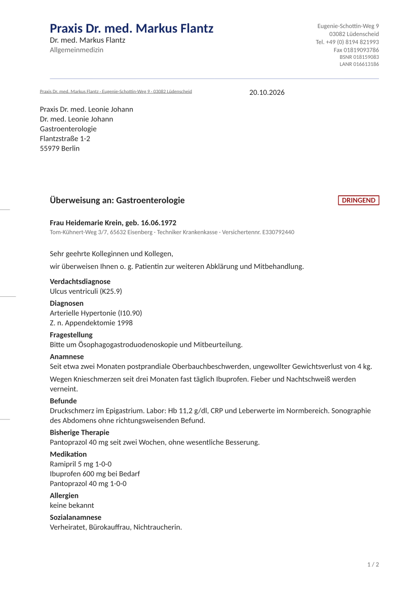

# AetioReferral: Synthetic Medical Referral Letter Generator

**AetioReferral is an open-source Python MCP server and CLI that generates realistic synthetic medical referral letters as PDF: a German Überweisungsbrief (Arztbrief) from a general practitioner to a specialist, or the same letter in any other language with a locale file. It is built for medical education, virtual-patient platforms and document-AI datasets.**


## Table of Contents

1. [What is AetioReferral?](#what-is-aetioreferral)
2. [Example Letter](#example-letter)
3. [Key Features](#key-features)
4. [Use Cases](#use-cases)
5. [How AetioReferral Compares](#how-aetioreferral-compares)
6. [Quick Start](#quick-start)
7. [Use with Claude and Other MCP Clients](#use-with-claude-and-other-mcp-clients)
8. [Letter Input](#letter-input)
9. [Languages](#languages)
10. [FAQ](#faq)
11. [Related Projects](#related-projects)
12. [License](#license)
13. [Developer Guide](README-DEV.md)

## What is AetioReferral?

AetioReferral turns letter content into a finished, realistic referral letter PDF. The caller supplies the clinical content, such as the reason for referral, history, findings and medication. AetioReferral adds everything around it: letterhead, recipient address, patient line, salutation, closing, handwritten-style signature and practice stamp, laid out as a DIN 5008 business letter.

There are two ways to use it:

- **Render**: pass the letter content as structured JSON. No LLM is needed, and the result is deterministic.
- **Generate**: pass a free-text description such as "GP refers a 67-year-old man with exertional chest tightness to cardiology". A configured LLM writes the letter content the way a real referring doctor would, then the letter is rendered.

Patient, doctor and practice details that the caller leaves out are generated with Faker, so every letter is fictional. AetioReferral is not for clinical use.

## Example Letter



Rendered from [`examples/letter.json`](examples/letter.json) with `--seed 7`. Every name, address and identifier on it is generated.

## Key Features

- **Realistic letter layout**: DIN 5008 Form B with letterhead, address window, fold marks, patient line, urgent marker, signature in a handwriting font and a practice stamp with BSNR and LANR.
- **Real letter sections**: Verdachtsdiagnose (suspected diagnosis), Diagnosen, Fragestellung (reason for referral), Anamnese, Befunde, Bisherige Therapie, Medikation, Allergien, free extra sections and Anlagen (enclosures). Empty sections leave no trace.
- **Field-by-field identity filling**: anything you give is kept, anything missing is generated. Send `"patient": null` for a letter without patient details.
- **Reproducible**: the same input and seed always produce the same letter, and every result returns its seed.
- **Language-agnostic**: every label and phrase the service adds lives in one locale file per language. German and English are included.
- **Optional LLM**: Anthropic, OpenAI, Google Gemini, OpenRouter, Ollama or any other pydantic-ai provider, configured by environment variables or a `.env` file. Without an LLM, the generate path does not exist at all.
- **Two interfaces**: an MCP server (stdio or streamable HTTP) for LLM clients and agents, and a command-line tool for scripts.

## Use Cases

- **Medical education**: give students a referral letter as part of a virtual patient case, as in the sister project [AetioMed](https://github.com/janthoXO/AetioMed).
- **Document AI and OCR datasets**: produce many varied, realistic clinical letters with known ground truth for training and testing extraction models, without touching real patient data.
- **Testing clinical software**: feed realistic letters into document-management, inbox or parsing pipelines.
- **Agents and chat clients**: let Claude or another MCP client create a letter during a conversation.

## How AetioReferral Compares

| Approach | Realistic letter layout | Structured, reproducible output | Real patient data needed | Writes clinical content |
| --- | --- | --- | --- | --- |
| AetioReferral | Yes, DIN 5008 PDF with signature and stamp | Yes, JSON in, PDF and filled JSON out, seeded | No | Optional, via LLM |
| Prompting an LLM directly | No, plain text | No | No | Yes |
| Word or HTML templates | Depends on the template | Partly | No | No |
| De-identified real letters | Yes | No | Yes, plus legal review | Not applicable |

## Quick Start

Requirements: Python 3.13 and [uv](https://docs.astral.sh/uv/).

```sh
git clone https://github.com/janthoXO/AetioReferral.git
cd AetioReferral
uv sync
```

Render the example letter:

```sh
uv run aetioreferral render examples/letter.json -o letter.pdf
```

Render from stdin with a fixed seed:

```sh
echo '{"recipient_specialty": "Kardiologie", "reason": "Abklärung einer Belastungsdyspnoe"}' \
  | uv run aetioreferral render - -o letter.pdf --seed 42
```

To write letters from free text, configure an LLM. Copy `.env.example` to `.env` and fill in a provider, model and API key, then:

```sh
uv run aetioreferral generate "Hausärztin überweist eine 54-jährige Patientin mit Oberbauchschmerzen dringend zur ÖGD" -o letter.pdf
```

Run `uv run aetioreferral --help` for all commands.

## Use with Claude and Other MCP Clients

AetioReferral speaks the [Model Context Protocol](https://modelcontextprotocol.io). Add it to Claude Code:

```sh
claude mcp add aetioreferral -- uv run --directory /path/to/AetioReferral aetioreferral mcp
```

Or to any client that reads an `mcpServers` config, such as Claude Desktop:

```json
{
  "mcpServers": {
    "aetioreferral": {
      "command": "uv",
      "args": ["run", "--directory", "/path/to/AetioReferral", "aetioreferral", "mcp"]
    }
  }
}
```

For a networked deployment, run `uv run aetioreferral mcp --http` and connect to `http://127.0.0.1:8000/mcp`. The HTTP transport has no authentication yet, so keep it on localhost or a private network.

Tools:

- `render_referral_letter(letter, seed?)`: always available.
- `generate_referral_letter(description, language?, seed?)`: only when an LLM is configured.

Both return the PDF as an embedded resource (`application/pdf`) and the completed letter with its seed as structured content.

## Letter Input

The input is a `LetterSpec` JSON object. Only `recipient_specialty` and `reason` are required; every section is plain text.

```json
{
  "recipient_specialty": "Gastroenterologie",
  "reason": "Bitte um Ösophagogastroduodenoskopie und Mitbeurteilung.",
  "suspected_diagnosis": "Ulcus ventriculi",
  "history": "Seit zwei Monaten postprandiale Oberbauchbeschwerden, Gewichtsverlust von 4 kg.",
  "medication": "Ramipril 5 mg 1-0-0\nIbuprofen 600 mg bei Bedarf",
  "patient": {"sex": "f", "age": 54}
}
```

The patient has three states:

- **Omitted or `{}`**: the whole patient is generated.
- **Partly filled**: given fields are kept and the rest is generated.
- **`null`**: the letter has no patient block.

Sender and recipient work the same way, except that they cannot be set to `null`. See [`examples/letter.json`](examples/letter.json) for every field and the [Developer Guide](README-DEV.md#letter-model) for the full reference.

## Languages

`language` takes a BCP 47 tag; `de` is the default and `en` is included. Region tags fall back to their base language, so `de-AT` uses the German locale. Content you write is never translated: the locale only supplies what the service adds, such as headings, salutation, closing, date format and the kind of generated names and identifiers. To add a language, copy `src/aetioreferral/locales/de.toml` and translate it; no code changes are needed.

## FAQ

### What is AetioReferral?

AetioReferral is an open-source Python tool that generates synthetic medical referral letters as PDF. It runs as an MCP server and as a CLI, takes structured JSON or a free-text description, and lays the letter out like a real German Überweisungsbrief.

### What is an Überweisungsbrief?

An Überweisungsbrief is the letter a German doctor, usually a general practitioner (Hausarzt), writes when referring a patient to a specialist (Facharzt). It names the patient, states the reason for referral (Fragestellung) and summarises history, findings, suspected diagnosis and medication.

### Does AetioReferral use real patient data?

No. Every patient, doctor, practice, address and identifier is either supplied by the caller or generated with Faker. The output is fictional and must not be used as a medical document.

### Do I need an LLM?

No. The render path takes structured JSON and needs no LLM. An LLM is only needed to write letter content from a free-text description.

### Which LLMs does AetioReferral support?

Any provider that pydantic-ai supports, set with `LLM_PROVIDER`. Anthropic, OpenAI, Google Gemini, OpenRouter and Ollama work out of the box. Small local models can struggle with the letter schema; mid-size models such as gemma4:12b and cloud models work well.

### Which languages does AetioReferral support?

German and English are included. Any language can be added with one TOML locale file.

### How do I reproduce a letter?

Pass the same input and the seed from the earlier result (`--seed` on the CLI, `seed` in MCP). The seed is printed by the CLI and returned by every MCP call.

### How does AetioReferral relate to AetioMed?

[AetioMed](https://github.com/janthoXO/AetioMed) generates synthetic patient cases for medical education. AetioReferral renders the referral letter that such a case can start with. The [Developer Guide](README-DEV.md#aetiomed-integration) describes the integration.

## Related Projects

- [AetioMed](https://github.com/janthoXO/AetioMed): LLM-based synthetic medical case generator for medical education.

## License

AetioReferral is released under the [MIT License](LICENSE). The bundled fonts Carlito and Herr Von Muellerhoff are under the SIL Open Font License; see `src/aetioreferral/template/fonts/`.

## Developer Guide

Architecture, the full letter model, rendering, localisation, the LLM drafter, MCP and CLI details, testing and the AetioMed integration are in [README-DEV.md](README-DEV.md).
